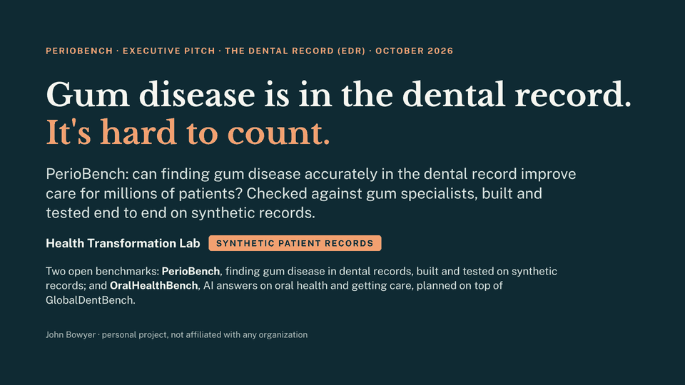
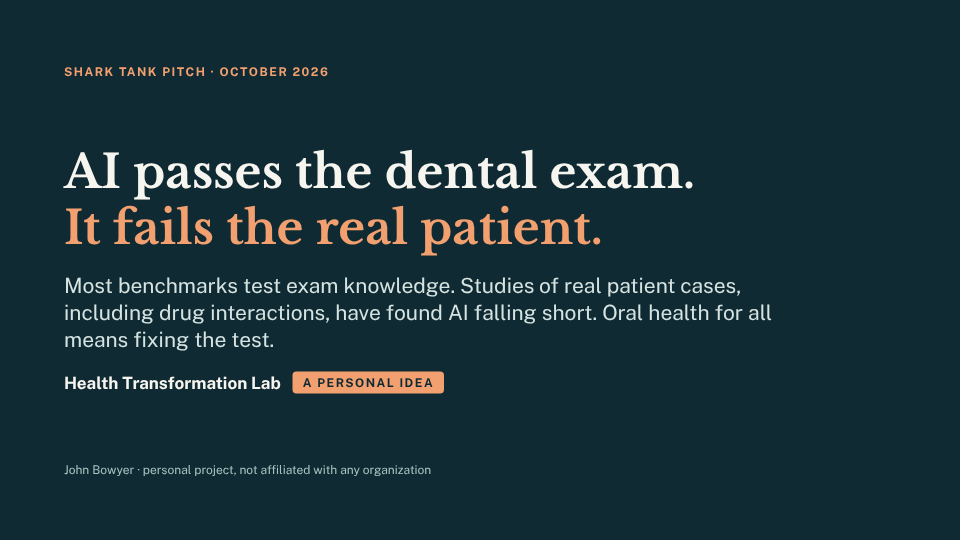

# Health Transformation Lab
**Evidence you can check.**

> **Personal learning project.** Built on my own time: not affiliated with or endorsed by any employer,
> institution or vendor, and nothing here is any organization's plan, study or finding. The patients are synthetic. See
> [DISCLAIMER.md](DISCLAIMER.md).

**The goal: better health answers from AI, and better care for the millions of people who ask.** More than 40
million people a day ask OpenAI's assistant alone about their health (OpenAI, January 2026), and those answers shape
the care they seek and get. AI developers such as OpenAI, Anthropic and Google improve what public benchmarks measure,
and no public benchmark we found checks answers where medicine meets dentistry, or whether an answer helps someone get
care. The lab builds them in the open: **PerioBench** (finding gum disease in dental records) works on synthetic
records; **OralHealthBench** is planned; **AccessBench** is exploratory. [healthtransformationlab.org](https://healthtransformationlab.org).

Three benchmarks so far, tested the same way (models, harm grades, leaderboards), each with a pitch and a drill-down.

## 1. PerioBench: better care for gum disease by finding it accurately in dental records

<a href="docs/edr/full_text_and_notes.md"></a>

Gum disease is written down at almost every dental visit, but in pieces (notes, forms, codes and measurements that
often disagree), so it is often missed and hard to link to diabetes care. A tool that finds it accurately in the whole
record (phenotyping, to researchers) lets clinics find it earlier and treat it. PerioBench scores how well rules and AI
find it; agreement with gum specialists reviewing the same record is the check, not the goal. It runs end to end on
**synthetic** records as three tests, each with its own models:

| Test | The question | What it reads | Models compared | Best so far (synthetic) | Drill-down |
|---|---|---|---|---|---|
| **Phenotyping** | What gum-disease status does this visit show (healthy or gingivitis, or stage 1 to 4)? | The note, or the whole record | Rules; BERT-family encoders trained on notes; LLMs (Llama 3.3 70B, MedGemma) | Note alone, AI: **203 of 223** (ModernBERT-large + stage 4 rule); whole record, rules: 207 (flattering: the key uses the same rules) | [ranking and drivers](docs/model_drivers.md) |
| **De-identification** | Which words are private (names, dates, IDs) and must go before anyone reads the note? | The note | Pattern rules; Presidio; two BERT-family taggers (Stanford, OBI); Databricks AI mask; combinations | Stanford + OBI + patterns + dental guard: leaks **115 of 2,714** identifiers, damages 41 of 2,462 dental terms | [the benchmark](docs/deidentification.md), [ranking and drivers](docs/deid_drivers.md) |
| **Tooth loss** | Was this missing tooth lost to gum disease? (Five or more makes stage 4.) | Structured tables: probing, extraction codes, missing teeth; no text | Logistic regression; XGBoost | AUC **0.89** and **0.90** on 469 held-out teeth | [the model](docs/tooth_loss.md), [other models compared](docs/tooth_loss_drivers.md) |

Scored against the generator's answer key: agreement, not accuracy on real patients ([how scoring works](docs/scoring.md),
[presets](docs/presets.md)). De-identification comes first on real notes; tooth loss feeds the stage 4 count.

| For | Go to |
|---|---|
| **Executives** (7 slides, plus backup) | [read the pitch with speaker notes](docs/edr/full_text_and_notes.md) · [slides](docs/edr/deck.html) (download and open in a browser) |
| **Scientists** | [the study](docs/edr/README.md): the seven kinds of evidence, the three tests with 95% intervals, the acceptance test, the models |
| **Engineers** | [code walkthrough](docs/code_walkthrough.md), [deployment](docs/deployment.md), [how we work](AGENTS.md) |

## 2. OralHealthBench (planned): correct answers where medicine meets dentistry

<a href="docs/pitch/full_text_and_notes.md"></a>

Twelve leading AI models average 81% on dental licensing-exam questions but 22% on questions built from published
patient cases (GlobalDentBench, 2026). Studies of real patient cases found the same gap: on real hospital cases, models
didn't follow the clinical guidelines doctors use (Hager et al., 2024); people using them did no better than people
using a source of their choice (Bean et al., 2026); and against a standard drug-interaction checker, ChatGPT-3.5 got
47% of 255 drug pairs right (Al-Ashwal et al., 2023). OralHealthBench, planned on GlobalDentBench, will ask where
dentistry meets medicine (a medicine that makes an extraction unsafe), traced to published evidence and built from
PerioBench's synthetic OMOP patients, and measure how much an open evidence agent improves the answers.

| For | Go to |
|---|---|
| **Executives** (7 slides, plus backup) | [read the pitch with speaker notes](docs/pitch/full_text_and_notes.md) · [slides](docs/pitch/deck.html) (download and open in a browser) |
| **Detail** | [the pitch's sources and how this repo tests it](docs/pitch/README.md) |

## 3. AccessBench (exploratory): does the answer get you care?

A right answer can still miss that Medicaid dental differs by state, that a denial can be appealed, or a low-cost route.
AccessBench scores whether it names this person's next concrete step, in three sections: oral health first, then medical
and mental ([ADR 0014](docs/adr/0014-accessbench-oral-medical-mental-sections.md)). The first 15 oral [questions](benchmarks/access_bench/README.md)
are synthetic, from real public asks; discount and voucher questions are next. A Databricks job scores them; **no live scores yet**.

| For | Go to |
|---|---|
| **Executives** (7 slides) | [read the pitch with speaker notes](docs/access/full_text_and_notes.md) · [slides](docs/access/deck.html) · [PowerPoint](docs/access/access_bench.pptx) |

## Run it

```bash
cd python && pip install -e ".[dev]"
pytest -q tests                                    # Python tests
cd .. && python/scripts/make_parity_inputs.sh && Rscript r/tests/test_parity.R   # Python and R give the same numbers
python docs/build_decks.py && python docs/build_pptx.py   # rebuild the decks, and the AccessBench PowerPoint
```

Ground rules: synthetic patient records, never identifiable patient data (PHI); Python and R in parity; anything simulated is labelled simulated
([AGENTS.md](AGENTS.md)). Open decisions: [action items](docs/action_items.md). Gold-table data contracts (ODCS): [contracts/](contracts/README.md). Owner John Bowyer · Apache 2.0 licence.
