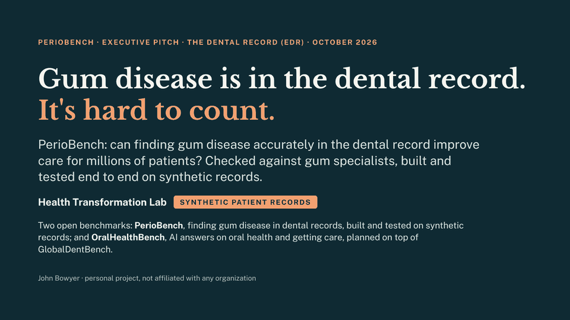
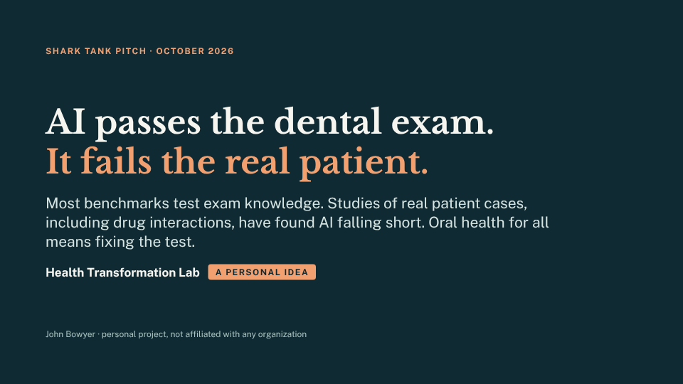

# Health Transformation Lab

> **Personal learning project.** Built on my own time: not affiliated with or endorsed by any employer,
> institution or vendor, and nothing here is any organization's plan, study or finding. The patients are synthetic. See
> [DISCLAIMER.md](DISCLAIMER.md).

**The goal: better health answers from AI, and better care for the millions of people who ask.** More than 40
million people a day ask OpenAI's assistant alone about their health (OpenAI, January 2026), and those answers shape
the care they seek and get. AI developers such as OpenAI, Anthropic and Google improve what public benchmarks measure,
and no public benchmark we found checks answers where medicine meets dentistry, or whether an answer helps someone get
care. The lab builds its benchmarks in the open: **PerioBench** (finding gum disease in dental records) has working
code and results on synthetic records; **OralHealthBench** (AI answers on oral health and getting care) is planned,
building on GlobalDentBench; and **AccessBench** (whether an answer helps someone get care) is exploratory.
[healthtransformationlab.org](https://healthtransformationlab.org).

Two benchmarks so far, each with a short pitch that drills down to the detail.

## 1. PerioBench: better care for gum disease by finding it accurately in dental records

<a href="docs/edr/full_text_and_notes.md"></a>

The goal is better care for people with periodontitis. Gum disease is written down at almost every dental visit,
but in pieces: notes, forms, codes and measurements that often disagree, so it is often missed, hard to follow over
time, and hard to link to diabetes care. A tool that reads the whole record and finds gum disease accurately
(phenotyping, to researchers) lets clinics find it earlier and treat it. PerioBench scores how well rules and AI find
it in the record; agreement with gum specialists reviewing the same record is how that is checked, not the goal.
It runs end to end on **synthetic** records:

- the whole record, by rules that read the gum measurements first: **215 of 221** (flattering: the key uses the same rules);
- the free-text note alone, read by a small trained model with a stage 4 rule: **201 of 221**;
- a bigger medical AI used as is, with the same rule: **181 of 221** (MedGemma 4B; the newer MedGemma 1.5 4B got 177).

Synthetic charts, scored against the generator's answer key: agreement with it, not accuracy on real patients ([how
scoring works](docs/scoring.md)), on the 221 of the 240 review charts from adults' visits since April 2021, with healthy
and gingivitis counted as one group (the defaults: [presets](docs/presets.md)). **Order matters:** when the measurements, exam form, codes and note disagree, rules must
pick one to believe first. Measurements first gives 215; exam form first (the study design's order) gives 163.

| For | Go to |
|---|---|
| **Executives** (11 slides, 10 minutes) | [read the pitch with speaker notes](docs/edr/full_text_and_notes.md) · [slides](docs/edr/deck.html) (download and open in a browser) |
| **Scientists** | [the study](docs/edr/README.md): the seven kinds of evidence, every method with 95% intervals, the acceptance test, models, de-identification |
| **Engineers** | [code walkthrough](docs/code_walkthrough.md), [deployment](docs/deployment.md), [how we work](AGENTS.md) |

## 2. OralHealthBench (planned): correct answers where medicine meets dentistry

<a href="docs/pitch/full_text_and_notes.md"></a>

Twelve leading AI models average 81% on dental licensing-exam questions but 22% on questions built from published
patient cases (GlobalDentBench, 2026). Most benchmarks test exam knowledge, and studies of real patient cases have found the same gap: on real
hospital cases, models didn't follow the clinical guidelines doctors use (Hager et al., 2024); people using them
did no better than people using a source of their choice (Bean et al., 2026); and against a standard drug-interaction
checker, ChatGPT-3.5 got 47% of 255 drug pairs right (Al-Ashwal et al., 2023). OralHealthBench, planned
and building on GlobalDentBench, will ask real-world questions where dentistry meets medicine, such as a medicine that
makes a tooth extraction unsafe, each traced to published evidence, with public results so improvements are visible,
and will measure how much an open evidence agent improves their answers. A third idea, **AccessBench**, is exploratory:
it would ask whether an answer works for someone with no coverage, no car or no dentist nearby.

| For | Go to |
|---|---|
| **Executives** (6 slides, plus backup) | [read the pitch with speaker notes](docs/pitch/full_text_and_notes.md) · [slides](docs/pitch/deck.html) (download and open in a browser) |
| **Detail** | [the pitch's sources and how this repo tests it](docs/pitch/README.md) |

## How the two paths connect

The dental record path builds synthetic patients whose right answers are known, in OMOP, the format medicine
already uses. Those patients become test questions for OralHealthBench. AI is tested the same way at every step, with the same
models, harm grades and leaderboards: first on gum charts, then on case questions, then on broader medical-dental
questions.

## Run it

```bash
cd python && pip install -e ".[dev]"
pytest -q tests                                    # Python tests
cd .. && python/scripts/make_parity_inputs.sh && Rscript r/tests/test_parity.R   # Python and R give the same numbers
python docs/build_decks.py                         # rebuild both decks from docs/<deck>/slides/
```

Ground rules: synthetic patient records, never identifiable patient data (PHI); Python and R in parity; anything simulated is labelled simulated
([AGENTS.md](AGENTS.md)). Open decisions: [action items](docs/action_items.md). Owner John Bowyer · MIT licence.
