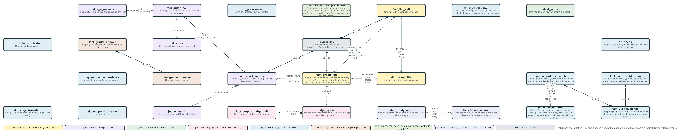

# Gold data model: `health_transformation_lab.gold_perio_bench`

Generated from [`_build/gold_model.py`](../_build/gold_model.py) by `_build/gold_erd.py`; `python/tests/test_gold_model.py` checks the columns against the CSV twins and `results_store`. Names follow AGENTS.md, SQL and data names (spec 018). Keys are logical: Delta enforces none. Solid lines are keys; dashed lines are summaries or matches, not keys. PNGs are in this folder; the draw.io and Mermaid sources are in `source/`. Who writes each table and why: [docs/gold_tables.md](../../docs/gold_tables.md). Synthetic data only.



## Tables and relationships (entity)

```mermaid
erDiagram
    dim_result_file |o--o{ fact_prediction : "file_sha256 (repo · kaggle rows)"
    dim_result_file |o--o{ fact_llm_call : "file_sha256 (repo · kaggle rows)"
    fact_prediction }o..o{ fact_llm_call : "method_name, visit_id, source_code (per version or run)"
    review_key ||--o{ fact_prediction : "visit_id"
    review_key ||--o{ fact_llm_call : "visit_id"
    review_key ||--o{ fact_chart_answer : "visit_id"
    fact_judge_call |o--o{ fact_chart_answer : "visit_id, answer_status_code"
    judge_cost ||..o{ fact_judge_call : "call_kind_code"
    fact_judge_call }o..o{ judge_agreement : "status calls summarised"
    fact_chart_answer }o..o{ judge_metric : "system_name"
    fact_prediction }o..o{ fact_chart_answer : "method_name = system_name"
    fact_prediction ||..o| judge_queue : "sampled from"
    judge_queue ||--o| fact_corpus_judge_call : "method_name, visit_id"
    dim_grader_question ||--o{ fact_grader_answer : "question_id"
    fact_visit_evidence ||--o{ fact_case_profile_item : "visit_id"
    fact_visit_evidence ||--o{ fact_record_mismatch : "visit_id"
    fact_record_mismatch }o..o{ dq_mismatch_rule : "rule_name (scores are per rule and clinic: join on clinic_code too)"
    dim_study_note }o..o{ benchmark_metric : "run_id (its test split)"
    review_key
    dim_result_file
    fact_prediction
    fact_llm_call
    fact_chart_answer
    fact_judge_call
    judge_metric
    judge_agreement
    judge_cost
    deid_score
    judge_queue
    fact_corpus_judge_call
    dq_check
    dq_column_missing
    dq_prevalence
    dq_temporal_change
    dq_stage_transition
    dq_source_concordance
    fact_visit_evidence
    dq_injected_error
    fact_case_profile_item
    fact_record_mismatch
    dq_mismatch_rule
    dim_grader_question
    fact_grader_answer
    fact_tooth_loss_prediction
    dim_study_note
    benchmark_metric
```



## Every column (full)


```mermaid
erDiagram
    dim_result_file |o--o{ fact_prediction : "file_sha256 (repo · kaggle rows)"
    dim_result_file |o--o{ fact_llm_call : "file_sha256 (repo · kaggle rows)"
    fact_prediction }o..o{ fact_llm_call : "method_name, visit_id, source_code (per version or run)"
    review_key ||--o{ fact_prediction : "visit_id"
    review_key ||--o{ fact_llm_call : "visit_id"
    review_key ||--o{ fact_chart_answer : "visit_id"
    fact_judge_call |o--o{ fact_chart_answer : "visit_id, answer_status_code"
    judge_cost ||..o{ fact_judge_call : "call_kind_code"
    fact_judge_call }o..o{ judge_agreement : "status calls summarised"
    fact_chart_answer }o..o{ judge_metric : "system_name"
    fact_prediction }o..o{ fact_chart_answer : "method_name = system_name"
    fact_prediction ||..o| judge_queue : "sampled from"
    judge_queue ||--o| fact_corpus_judge_call : "method_name, visit_id"
    dim_grader_question ||--o{ fact_grader_answer : "question_id"
    fact_visit_evidence ||--o{ fact_case_profile_item : "visit_id"
    fact_visit_evidence ||--o{ fact_record_mismatch : "visit_id"
    fact_record_mismatch }o..o{ dq_mismatch_rule : "rule_name (scores are per rule and clinic: join on clinic_code too)"
    dim_study_note }o..o{ benchmark_metric : "run_id (its test split)"
    review_key {
        bigint visit_id PK "review chart (240)"
        string truth_status "the generator's truth"
        string difficulty "L1 · L2 · L3"
        string note_text "de-identified note, through the leak gate"
    }
    dim_result_file {
        string file_name "e.g. ai_predictions_bert-base.csv"
        string file_kind_code "predictions · llm_details"
        string method_name "method (rung) from the file name"
        string file_sha256 PK "SHA-256 of the file: its version"
        bigint row_count "rows in the file"
        string source_code "repo · kaggle (results_manifest.csv)"
        string run_url "Kaggle workflow run; empty for repo"
        string git_commit_sha "commit the bundle was deployed from"
        timestamp loaded_ts "when Load results wrote it"
    }
    fact_prediction {
        string method_name "method (rung), e.g. modernbert-base+cw"
        bigint visit_id PK, FK "review chart"
        string predicted_status_code "predicted status, one of six"
        string file_sha256 PK, FK "SHA-256 of the source file: its version (in dim_result_file for repo · kaggle rows only)"
        string source_code "repo · kaggle · databricks"
        string run_id "Databricks job run id (databricks rows)"
        timestamp run_ts "when the reader job ran (databricks rows); fact_llm_call: also the load time of Load results rows"
        string git_commit_sha "commit the job was deployed from"
        timestamp loaded_ts "when Load results wrote it (Load results rows)"
    }
    fact_llm_call {
        bigint visit_id PK, FK "review chart"
        string model_name "model id"
        string backend_code "hf (local weights) · openai (OpenAI-compatible endpoint)"
        string model_revision_id "Kaggle Models handle or Hugging Face commit of the weights; empty before #214"
        string prompt_version_code "e.g. reader-v2"
        bigint shot_count "few-shot examples in the prompt"
        bigint input_token_count "prompt tokens"
        bigint output_token_count "completion tokens"
        double latency_seconds "seconds for the call"
        string raw_response_text "the model's full reply"
        string answered_status_code "status the model answered"
        string answered_grade_code "grade the model answered"
        string answered_extent_code "extent the model answered"
        string quote_text "passage quoted from the note"
        boolean is_gate_ok "quote gate passed: the quote is verbatim in the note"
        string error_text "call or parse error"
        boolean is_fallback "gate failed, so the rules answered"
        string predicted_status_code "final status (= fact_prediction.predicted_status_code)"
        string method_name "method (rung), with shot and adapter tags"
        string file_sha256 PK, FK "SHA-256 of the source file: its version (in dim_result_file for repo · kaggle rows only)"
        string source_code "repo · kaggle · databricks"
        string run_id "Databricks job run id (databricks rows)"
        timestamp run_ts "when the reader job ran (databricks rows); fact_llm_call: also the load time of Load results rows"
        string git_commit_sha "commit the job was deployed from"
        timestamp loaded_ts "when Load results wrote it (Load results rows)"
        string truth_status_code "answer key truth (databricks rows)"
        string difficulty_code "L1 · L2 · L3 (databricks rows)"
    }
    fact_chart_answer {
        bigint visit_id PK, FK "review chart"
        string system_name PK "AI method, +rules4 variant, rule phenotype or one evidence type"
        string answer_status_code FK "the system's status; null = no answer"
        string difficulty_code "L1 · L2 · L3"
        string truth_status_code "the generator's truth"
    }
    fact_judge_call {
        bigint visit_id PK "review chart"
        string call_kind_code PK, FK "status (no answer shown) · verdict"
        string answer_status_code PK "answer judged (verdict rows)"
        string verdict_code "correct · incorrect · not_determinable"
        string judge_status_code "the judge's own status (status rows)"
        string quote_text "verbatim from the note"
        boolean is_gate_ok "quote gate and schema check passed"
        string gate_reason_text "why the gate failed"
        string endpoint_name "serving endpoint"
        string prompt_version_code "judge-status-v1 · judge-v2"
        bigint prompt_token_count "prompt tokens"
        bigint completion_token_count "completion tokens"
        double latency_seconds "seconds for the call"
        boolean is_simulated "true for the simulated judge"
        boolean is_api_error "endpoint failed after retries; asked again next run"
    }
    judge_metric {
        string system_name PK "as in fact_chart_answer"
        string group_name "README group, e.g. Trained AI on the note"
        string metric_code PK "correct · unsafe_rate · sensitivity · …"
        string metric_name "the metric's README name"
        double vs_truth_ratio "against the generator's truth (as in the README)"
        double vs_truth_judged_ratio "against truth, on charts the judge answered"
        double vs_judge_ratio "with the judge's status as reference"
        double difference_ratio "vs_judge − vs_truth"
        bigint judged_count "charts with a judge answer"
        double corrected_accuracy_ratio "Rogan-Gladen corrected accuracy from verdicts"
        double ci_low_ratio "95% interval, low"
        double ci_high_ratio "95% interval, high"
        double judged_correct_ratio "share the judge called correct"
        double verdict_sensitivity_ratio "verdicts vs truth: sensitivity"
        double verdict_specificity_ratio "verdicts vs truth: specificity"
    }
    judge_agreement {
        string slice_group_code PK "all · truth_status · difficulty"
        string slice_value_code PK "e.g. L3"
        string slice_name "display name"
        bigint chart_count "charts in the slice"
        double coverage_ratio "share the judge answered"
        double agreement_ratio "agreement with truth"
        double ci_low_ratio "95% interval, low"
        double ci_high_ratio "95% interval, high"
        double kappa_coef "Cohen's kappa"
    }
    judge_cost {
        string call_kind_code PK "status · verdict · all"
        bigint call_count "calls made"
        bigint chart_count "charts covered"
        bigint endpoint_error_count "calls the endpoint failed"
        bigint gate_failure_count "answers that failed the quote gate"
        bigint prompt_token_count "prompt tokens"
        bigint completion_token_count "completion tokens"
        double cost_usd "US$ at the endpoint's list price"
        double cost_per_chart_usd "US$ per chart"
        double avg_latency_seconds "mean seconds per answered call"
        double p50_latency_seconds "median seconds"
        double p95_latency_seconds "95th percentile seconds"
    }
    deid_score {
        string engine_name PK "de-identification engine"
        string tier_code PK "easy · hard · unseen · external · jsl48 · all"
        bigint note_count "notes in the tier"
        bigint phi_count "PHI spans"
        double entity_recall_ratio "PHI entities caught"
        double char_recall_ratio "PHI characters caught"
        double char_precision_ratio "removed characters that were PHI"
        double decoy_damage_ratio "clinical decoys wrongly removed"
        bigint hard_negative_count "hard negatives in the tier"
        double hard_negative_damage_ratio "hard negatives wrongly removed"
        double token_precision_ratio "token-level precision"
        double token_recall_ratio "token-level recall"
        double token_f1_ratio "token-level F1"
        double leaked_phi_per_1k_note_rate "PHI left per thousand notes"
        double avg_note_char_count "mean note length"
        string group_name "engine family (readme_results.deid_group)"
    }
    judge_queue {
        string method_name PK, FK "method (rung)"
        bigint visit_id PK, FK "chart or note"
        string note_text "de-identified note, through the leak gate"
        string predicted_status_code "the method's status, to judge"
    }
    fact_corpus_judge_call {
        string method_name PK, FK "method (rung)"
        bigint visit_id PK, FK "chart or note"
        string predicted_status_code "the status judged"
        string verdict_code "correct · incorrect · not_determinable"
        string supported_status_code "the status the judge says the note supports"
        string quote_text "verbatim from the note"
        string rationale_text "the judge's reason"
        boolean is_gate_ok "quote gate and schema check passed"
        string error_text "ai_query error"
        string prompt_version_code "judge-v2"
        string judge_model_name "serving endpoint"
    }
    dq_check {
        string check_name "e.g. plausibility:temporal_stage_drop"
        string check_category_code "conformance · completeness · plausibility"
        bigint checked_count "rows the check looked at"
        bigint failed_count "rows that failed it"
        double pass_ratio "1 - failed / checked"
        string check_status_code "PASS (none allowed, none found) · REPORT (a rate to read)"
        string clinic_code "1-8, or All"
        string source_files_text "the committed CSVs the table is built from"
        string file_sha256 "SHA-256 of those files together: the version"
        string git_commit_sha "commit the job was deployed from"
        timestamp loaded_ts "when Load results wrote it"
    }
    dq_column_missing {
        string evidence_column_name "column of the structured record"
        bigint row_count "visits"
        bigint missing_count "visits where it is empty"
        double missing_pct "missing / visits, 0-100"
        string source_files_text "the committed CSVs the table is built from"
        string file_sha256 "SHA-256 of those files together: the version"
        string git_commit_sha "commit the job was deployed from"
        timestamp loaded_ts "when Load results wrote it"
    }
    dq_prevalence {
        string method_name "status source: algorithm_design, notes, truth_status, ..."
        string level_code "clinic · scale"
        string group_name "clinic 1-8, or all_visits · complete_cases · reference_set"
        bigint subject_count "people (clinic) or visits with a status (scale)"
        double periodontitis_ratio "share with periodontitis"
        double periodontitis_ci_low_ratio "95% interval, low (clinic rows)"
        double periodontitis_ci_high_ratio "95% interval, high (clinic rows)"
        double stage3_4_ratio "share with stage III-IV"
        string source_files_text "the committed CSVs the table is built from"
        string file_sha256 "SHA-256 of those files together: the version"
        string git_commit_sha "commit the job was deployed from"
        timestamp loaded_ts "when Load results wrote it"
    }
    dq_temporal_change {
        string method_name "status source"
        bigint later_visit_count "visits after a patient's first"
        double perio_resolved_ratio "later visits where periodontitis disappeared"
        double stage_drop_ratio "later visits where the stage dropped"
        bigint visit_pair_count "pairs 1-2 years apart, no treatment between"
        double better_ratio "pairs whose stage improved: implausible"
        double same_ratio "pairs with the same stage"
        double worse_ratio "pairs whose stage worsened"
        string source_files_text "the committed CSVs the table is built from"
        string file_sha256 "SHA-256 of those files together: the version"
        string git_commit_sha "commit the job was deployed from"
        timestamp loaded_ts "when Load results wrote it"
    }
    dq_stage_transition {
        string method_name "algorithm_design"
        string from_status_code "stage at the earlier visit"
        string to_status_code "stage at the next"
        bigint visit_pair_count "visit pairs"
        double row_pct "share of the earlier stage's pairs, 0-100"
        string direction_code "better · same · worse"
        string source_files_text "the committed CSVs the table is built from"
        string file_sha256 "SHA-256 of those files together: the version"
        string git_commit_sha "commit the job was deployed from"
        timestamp loaded_ts "when Load results wrote it"
    }
    dq_source_concordance {
        string method_a_name "first source"
        string method_b_name "second source"
        bigint visit_count "visits where both give a value"
        double agreement_ratio "share that agree"
        double kappa_coef "Cohen's kappa"
        string level_code "status · stage · ..."
        string source_files_text "the committed CSVs the table is built from"
        string file_sha256 "SHA-256 of those files together: the version"
        string git_commit_sha "commit the job was deployed from"
        timestamp loaded_ts "when Load results wrote it"
    }
    fact_visit_evidence {
        bigint visit_id PK "visit"
        bigint person_id "patient"
        date visit_date "date of the visit (synthetic)"
        bigint visit_seq_num "0 = the patient's first visit"
        boolean is_in_review "one of the 240 review charts"
        string note_status_code "status read from the chart note"
        string exam_form_status_code "from the exam form; unknown when missing"
        string dx_completed_status_code "from diagnosis codes on completed procedures"
        string dx_planned_status_code "from diagnosis codes on planned procedures"
        string probing_chart_status_code "from gum measurements; unknown when not charted"
        string rules_v0_status_code "rules, gum measurements first"
        string rules_design_status_code "rules in the study design's order"
        string rules_patel2022_status_code "rules in the order of Patel et al. 2022 (spec 024)"
        string truth_status_code "the generator's truth"
        string clinic_code "clinic 1-8"
        string source_files_text "the committed CSVs the table is built from"
        string file_sha256 "SHA-256 of those files together: the version"
        string git_commit_sha "commit the job was deployed from"
        timestamp loaded_ts "when Load results wrote it"
    }
    dq_injected_error {
        bigint injected_error_count "errors injected"
        double caught_ratio "share the temporal checks flag"
        double false_flag_ratio "visits flagged with no error injected"
        string source_files_text "the committed CSVs the table is built from"
        string file_sha256 "SHA-256 of those files together: the version"
        string git_commit_sha "commit the job was deployed from"
        timestamp loaded_ts "when Load results wrote it"
    }
    fact_case_profile_item {
        bigint visit_id PK "visit"
        string category_name "Demographics · Presentation · Visit context · Measurements · Tests and imaging · Risk factors · Treatment · Other readings · After the visit"
        bigint category_order_num "1 = Demographics, shown first"
        string item_name PK "what the row shows, e.g. max attachment loss (CAL)"
        bigint item_order_num "position in the profile"
        string item_value_name "the value as shown: a number, a status code, yes/no, or not recorded"
        string item_unit_name "mm, %, years, teeth; empty when none"
        string source_files_text "the committed CSVs the table is built from"
        string file_sha256 "SHA-256 of those files together: the version"
        string git_commit_sha "commit the job was deployed from"
        timestamp loaded_ts "when Load results wrote it"
    }
    fact_record_mismatch {
        bigint visit_id PK "visit"
        string rule_name PK "code_vs_chart · code_above_chart · code_below_chart · no_periodontal_care · code_vs_radiograph · stage_drop"
        string rule_label_name "the rule in plain words"
        string mismatch_evidence_text "the values that triggered it"
        bigint related_visit_id "stage drops: the earlier visit with the higher code; else null"
        bigint failed_rule_count "how many rules this visit fails: the visits failing most come first"
        string clinic_code "clinic 1-8"
        boolean is_injected_error "the visit carries an injected charting error (synthetic answer key)"
        string source_files_text "the committed CSVs the table is built from"
        string file_sha256 "SHA-256 of those files together: the version"
        string git_commit_sha "commit the job was deployed from"
        timestamp loaded_ts "when Load results wrote it"
    }
    dq_mismatch_rule {
        string rule_name PK "a rule, or any_rule"
        string rule_label_name "the rule in plain words"
        string clinic_code PK "clinic 1-8, or All"
        bigint checkable_count "visits with a code and the evidence the rule needs"
        bigint not_checkable_count "visits with a code but missing that evidence"
        bigint flagged_count "checkable visits the rule flags"
        bigint code_truth_mismatch_count "checkable visits whose code differs from the truth (stage drops: either visit's)"
        bigint true_flag_count "flags where the code differs from the truth"
        double precision_ratio "true flags / flags"
        double recall_ratio "true flags / code-truth mismatches"
        bigint only_rule_count "flags at visits failing no other rule"
        bigint injected_checkable_count "checkable visits with an injected charting error"
        bigint injected_caught_count "of those, flagged"
        string source_files_text "the committed CSVs the table is built from"
        string file_sha256 "SHA-256 of those files together: the version"
        string git_commit_sha "commit the job was deployed from"
        timestamp loaded_ts "when Load results wrote it"
    }
    dim_grader_question {
        string question_id PK "q001 ..."
        string category_name "Access to care · Clinical cases · Medical-dental integration · ..."
        bigint category_order_num "1 = access to care, shown first"
        string level_code "L1 recall · L2 routine reasoning · L3 individualized reasoning"
        bigint key_point_count "key points a full answer covers"
        string source_text "the published evidence behind the question"
        boolean is_simulated "true for the simulated sample"
        string source_files_text "the committed CSVs the table is built from"
        string file_sha256 "SHA-256 of those files together: the version"
        string git_commit_sha "commit the job was deployed from"
        timestamp loaded_ts "when Load results wrote it"
    }
    fact_grader_answer {
        string question_id FK "question"
        string model_name "model answering; sim: names in the sample"
        boolean is_with_agent "answered with the open agent"
        bigint covered_key_point_count "key points the answer covered"
        double score_ratio "covered / key points"
        string harm_code "S0 safe · S1 reversible harm · S2 irreversible harm"
        double cost_usd "cost of the answer"
        string judge_model_name "judge; never a family under test"
        string run_id "the grading run"
        boolean is_simulated "true for the simulated sample"
        string source_files_text "the committed CSVs the table is built from"
        string file_sha256 "SHA-256 of those files together: the version"
        string git_commit_sha "commit the job was deployed from"
        timestamp loaded_ts "when Load results wrote it"
    }
    fact_tooth_loss_prediction {
        bigint patient_id PK "Open Dental PatNum (synthetic)"
        bigint tooth_num PK "universal tooth number 1-32"
        string tooth_status_code "how the tooth left the record (silver patient_tooth)"
        string label_set_code PK "completed · completed_planned (FR-010)"
        string feature_set_code PK "shared (applied model) · own (with the tooth's own measures)"
        string model_name PK "logistic · xgboost"
        string split_code "train · test (held-out patients) · applied (no recorded reason)"
        double perio_loss_probability_ratio "P(lost to periodontitis), 0 to 1"
        double threshold_ratio "the fixed threshold, 0.5"
        boolean is_predicted_perio_loss "probability at or above the threshold"
        bigint generator_seed_num "seed of the synthetic extract"
        boolean is_synthetic "always true: synthetic data only"
        string run_id PK "Databricks job run id: the batch key"
        timestamp run_ts "when the job ran"
        string git_commit_sha "commit the job was deployed from"
    }
    dim_study_note {
        bigint note_id PK "OMOP note_id (= visit_occurrence_id)"
        bigint person_id "OMOP person_id; the split is by person"
        string note_text "the synthetic SOAP note"
        string truth_status_code "the generator's label, one of six"
        double max_probing_depth_mm "deepest probing depth on the chart"
        double bop_pct "sites bleeding on probing"
        double max_cal_mm "greatest clinical attachment loss"
        double rbl_pct "radiographic bone loss"
        bigint perio_lost_tooth_count "teeth lost to periodontitis"
        string split_code "train · test"
        string run_id "Databricks job run that built it"
        timestamp run_ts "when that run wrote it"
        string git_commit_sha "commit the job was deployed from"
    }
    benchmark_metric {
        string model_run_id PK "one model fit (eval/score.py run_id)"
        string method_name "method (rung), e.g. tfidf_logreg"
        string language_code "python · r"
        string metric_code PK "macro_f1 · f1 · sensitivity · specificity · ppv · npv · auroc"
        string class_status_code PK "the status an f1 row is for; empty for the others"
        double metric_ratio "the metric's value, 0 to 1; null when undefined"
        bigint test_note_count "notes in the test split"
        timestamp scored_ts "when the fit was scored"
        string run_id PK "Databricks job run: the batch key"
        timestamp run_ts "when that run wrote it"
        string git_commit_sha "commit the job was deployed from"
    }
```

### `review_key`

One per synthetic review chart (answer_key/review_key.csv, not a table). Written by: 10_build_study.py (seeded).

| Key | Column | Type | Description |
|---|---|---|---|
| PK | `visit_id` | bigint | review chart (240) |
|  | `truth_status` | string | the generator's truth |
|  | `difficulty` | string | L1 · L2 · L3 |
|  | `note_text` | string | de-identified note, through the leak gate |

### `dim_result_file`

One per committed result file version. Written by: Load results: delete-then-append by file_sha256, written last.

| Key | Column | Type | Description |
|---|---|---|---|
|  | `file_name` | string | e.g. ai_predictions_bert-base.csv |
|  | `file_kind_code` | string | predictions · llm_details |
|  | `method_name` | string | method (rung) from the file name |
| PK | `file_sha256` | string | SHA-256 of the file: its version |
|  | `row_count` | bigint | rows in the file |
|  | `source_code` | string | repo · kaggle (results_manifest.csv) |
|  | `run_url` | string | Kaggle workflow run; empty for repo |
|  | `git_commit_sha` | string | commit the bundle was deployed from |
|  | `loaded_ts` | timestamp | when Load results wrote it |

### `fact_prediction`

One per method and chart, per file version (key file_sha256 + visit_id) or reader run (key source_code + run_id + method_name + visit_id). Written by: Load results: delete-then-append by file_sha256 · MedGemma reader: replace (source_code, run_id, method_name).

| Key | Column | Type | Description |
|---|---|---|---|
|  | `method_name` | string | method (rung), e.g. modernbert-base+cw |
| PK,FK | `visit_id` | bigint | review chart |
|  | `predicted_status_code` | string | predicted status, one of six |
| PK,FK | `file_sha256` | string | SHA-256 of the source file: its version (in dim_result_file for repo · kaggle rows only) |
|  | `source_code` | string | repo · kaggle · databricks |
|  | `run_id` | string | Databricks job run id (databricks rows) |
|  | `run_ts` | timestamp | when the reader job ran (databricks rows); fact_llm_call: also the load time of Load results rows |
|  | `git_commit_sha` | string | commit the job was deployed from |
|  | `loaded_ts` | timestamp | when Load results wrote it (Load results rows) |

### `fact_llm_call`

One per LLM reader call on a chart. Written by: as fact_prediction.

| Key | Column | Type | Description |
|---|---|---|---|
| PK,FK | `visit_id` | bigint | review chart |
|  | `model_name` | string | model id |
|  | `backend_code` | string | hf (local weights) · openai (OpenAI-compatible endpoint) |
|  | `model_revision_id` | string | Kaggle Models handle or Hugging Face commit of the weights; empty before #214 |
|  | `prompt_version_code` | string | e.g. reader-v2 |
|  | `shot_count` | bigint | few-shot examples in the prompt |
|  | `input_token_count` | bigint | prompt tokens |
|  | `output_token_count` | bigint | completion tokens |
|  | `latency_seconds` | double | seconds for the call |
|  | `raw_response_text` | string | the model's full reply |
|  | `answered_status_code` | string | status the model answered |
|  | `answered_grade_code` | string | grade the model answered |
|  | `answered_extent_code` | string | extent the model answered |
|  | `quote_text` | string | passage quoted from the note |
|  | `is_gate_ok` | boolean | quote gate passed: the quote is verbatim in the note |
|  | `error_text` | string | call or parse error |
|  | `is_fallback` | boolean | gate failed, so the rules answered |
|  | `predicted_status_code` | string | final status (= fact_prediction.predicted_status_code) |
|  | `method_name` | string | method (rung), with shot and adapter tags |
| PK,FK | `file_sha256` | string | SHA-256 of the source file: its version (in dim_result_file for repo · kaggle rows only) |
|  | `source_code` | string | repo · kaggle · databricks |
|  | `run_id` | string | Databricks job run id (databricks rows) |
|  | `run_ts` | timestamp | when the reader job ran (databricks rows); fact_llm_call: also the load time of Load results rows |
|  | `git_commit_sha` | string | commit the job was deployed from |
|  | `loaded_ts` | timestamp | when Load results wrote it (Load results rows) |
|  | `truth_status_code` | string | answer key truth (databricks rows) |
|  | `difficulty_code` | string | L1 · L2 · L3 (databricks rows) |

### `fact_chart_answer`

One per system and review chart (README leaderboard systems). Written by: Judge scorecard: overwrite.

| Key | Column | Type | Description |
|---|---|---|---|
| PK,FK | `visit_id` | bigint | review chart |
| PK | `system_name` | string | AI method, +rules4 variant, rule phenotype or one evidence type |
| FK | `answer_status_code` | string | the system's status; null = no answer |
|  | `difficulty_code` | string | L1 · L2 · L3 |
|  | `truth_status_code` | string | the generator's truth |

### `fact_judge_call`

One per judge call: a chart's status, or a verdict on one answer. Written by: Judge scorecard: overwrite, earlier calls kept and resumed.

| Key | Column | Type | Description |
|---|---|---|---|
| PK | `visit_id` | bigint | review chart |
| PK,FK | `call_kind_code` | string | status (no answer shown) · verdict |
| PK | `answer_status_code` | string | answer judged (verdict rows) |
|  | `verdict_code` | string | correct · incorrect · not_determinable |
|  | `judge_status_code` | string | the judge's own status (status rows) |
|  | `quote_text` | string | verbatim from the note |
|  | `is_gate_ok` | boolean | quote gate and schema check passed |
|  | `gate_reason_text` | string | why the gate failed |
|  | `endpoint_name` | string | serving endpoint |
|  | `prompt_version_code` | string | judge-status-v1 · judge-v2 |
|  | `prompt_token_count` | bigint | prompt tokens |
|  | `completion_token_count` | bigint | completion tokens |
|  | `latency_seconds` | double | seconds for the call |
|  | `is_simulated` | boolean | true for the simulated judge |
|  | `is_api_error` | boolean | endpoint failed after retries; asked again next run |

### `judge_metric`

One per system and README metric. Written by: Judge scorecard: overwrite.

| Key | Column | Type | Description |
|---|---|---|---|
| PK | `system_name` | string | as in fact_chart_answer |
|  | `group_name` | string | README group, e.g. Trained AI on the note |
| PK | `metric_code` | string | correct · unsafe_rate · sensitivity · … |
|  | `metric_name` | string | the metric's README name |
|  | `vs_truth_ratio` | double | against the generator's truth (as in the README) |
|  | `vs_truth_judged_ratio` | double | against truth, on charts the judge answered |
|  | `vs_judge_ratio` | double | with the judge's status as reference |
|  | `difference_ratio` | double | vs_judge − vs_truth |
|  | `judged_count` | bigint | charts with a judge answer |
|  | `corrected_accuracy_ratio` | double | Rogan-Gladen corrected accuracy from verdicts |
|  | `ci_low_ratio` | double | 95% interval, low |
|  | `ci_high_ratio` | double | 95% interval, high |
|  | `judged_correct_ratio` | double | share the judge called correct |
|  | `verdict_sensitivity_ratio` | double | verdicts vs truth: sensitivity |
|  | `verdict_specificity_ratio` | double | verdicts vs truth: specificity |

### `judge_agreement`

One per slice: the judge's status against the truth. Written by: Judge scorecard: overwrite.

| Key | Column | Type | Description |
|---|---|---|---|
| PK | `slice_group_code` | string | all · truth_status · difficulty |
| PK | `slice_value_code` | string | e.g. L3 |
|  | `slice_name` | string | display name |
|  | `chart_count` | bigint | charts in the slice |
|  | `coverage_ratio` | double | share the judge answered |
|  | `agreement_ratio` | double | agreement with truth |
|  | `ci_low_ratio` | double | 95% interval, low |
|  | `ci_high_ratio` | double | 95% interval, high |
|  | `kappa_coef` | double | Cohen's kappa |

### `judge_cost`

One per call type: status · verdict · all. Written by: Judge scorecard: overwrite.

| Key | Column | Type | Description |
|---|---|---|---|
| PK | `call_kind_code` | string | status · verdict · all |
|  | `call_count` | bigint | calls made |
|  | `chart_count` | bigint | charts covered |
|  | `endpoint_error_count` | bigint | calls the endpoint failed |
|  | `gate_failure_count` | bigint | answers that failed the quote gate |
|  | `prompt_token_count` | bigint | prompt tokens |
|  | `completion_token_count` | bigint | completion tokens |
|  | `cost_usd` | double | US$ at the endpoint's list price |
|  | `cost_per_chart_usd` | double | US$ per chart |
|  | `avg_latency_seconds` | double | mean seconds per answered call |
|  | `p50_latency_seconds` | double | median seconds |
|  | `p95_latency_seconds` | double | 95th percentile seconds |

### `deid_score`

One per de-identification engine and test tier. Written by: Judge scorecard: overwrite, from data/deid/scores.csv.

| Key | Column | Type | Description |
|---|---|---|---|
| PK | `engine_name` | string | de-identification engine |
| PK | `tier_code` | string | easy · hard · unseen · external · jsl48 · all |
|  | `note_count` | bigint | notes in the tier |
|  | `phi_count` | bigint | PHI spans |
|  | `entity_recall_ratio` | double | PHI entities caught |
|  | `char_recall_ratio` | double | PHI characters caught |
|  | `char_precision_ratio` | double | removed characters that were PHI |
|  | `decoy_damage_ratio` | double | clinical decoys wrongly removed |
|  | `hard_negative_count` | bigint | hard negatives in the tier |
|  | `hard_negative_damage_ratio` | double | hard negatives wrongly removed |
|  | `token_precision_ratio` | double | token-level precision |
|  | `token_recall_ratio` | double | token-level recall |
|  | `token_f1_ratio` | double | token-level F1 |
|  | `leaked_phi_per_1k_note_rate` | double | PHI left per thousand notes |
|  | `avg_note_char_count` | double | mean note length |
|  | `group_name` | string | engine family (readme_results.deid_group) |

### `judge_queue`

One per prediction sampled for the corpus judge (stratified by method). Written by: built by hand; read by the LLM judge job.

| Key | Column | Type | Description |
|---|---|---|---|
| PK,FK | `method_name` | string | method (rung) |
| PK,FK | `visit_id` | bigint | chart or note |
|  | `note_text` | string | de-identified note, through the leak gate |
|  | `predicted_status_code` | string | the method's status, to judge |

### `fact_corpus_judge_call`

One per corpus judge call (ai_query). Written by: LLM judge (02_llm_judge.sql): create or replace.

| Key | Column | Type | Description |
|---|---|---|---|
| PK,FK | `method_name` | string | method (rung) |
| PK,FK | `visit_id` | bigint | chart or note |
|  | `predicted_status_code` | string | the status judged |
|  | `verdict_code` | string | correct · incorrect · not_determinable |
|  | `supported_status_code` | string | the status the judge says the note supports |
|  | `quote_text` | string | verbatim from the note |
|  | `rationale_text` | string | the judge's reason |
|  | `is_gate_ok` | boolean | quote gate and schema check passed |
|  | `error_text` | string | ai_query error |
|  | `prompt_version_code` | string | judge-v2 |
|  | `judge_model_name` | string | serving endpoint |

### `dq_check`

One per (data-quality check, clinic); clinic_code All = every clinic. Written by: Load results: overwrite.

| Key | Column | Type | Description |
|---|---|---|---|
|  | `check_name` | string | e.g. plausibility:temporal_stage_drop |
|  | `check_category_code` | string | conformance · completeness · plausibility |
|  | `checked_count` | bigint | rows the check looked at |
|  | `failed_count` | bigint | rows that failed it |
|  | `pass_ratio` | double | 1 - failed / checked |
|  | `check_status_code` | string | PASS (none allowed, none found) · REPORT (a rate to read) |
|  | `clinic_code` | string | 1-8, or All |
|  | `source_files_text` | string | the committed CSVs the table is built from |
|  | `file_sha256` | string | SHA-256 of those files together: the version |
|  | `git_commit_sha` | string | commit the job was deployed from |
|  | `loaded_ts` | timestamp | when Load results wrote it |

### `dq_column_missing`

One per evidence column. Written by: Load results: overwrite.

| Key | Column | Type | Description |
|---|---|---|---|
|  | `evidence_column_name` | string | column of the structured record |
|  | `row_count` | bigint | visits |
|  | `missing_count` | bigint | visits where it is empty |
|  | `missing_pct` | double | missing / visits, 0-100 |
|  | `source_files_text` | string | the committed CSVs the table is built from |
|  | `file_sha256` | string | SHA-256 of those files together: the version |
|  | `git_commit_sha` | string | commit the job was deployed from |
|  | `loaded_ts` | timestamp | when Load results wrote it |

### `dq_prevalence`

One per (method, clinic or scale). Written by: Load results: overwrite.

| Key | Column | Type | Description |
|---|---|---|---|
|  | `method_name` | string | status source: algorithm_design, notes, truth_status, ... |
|  | `level_code` | string | clinic · scale |
|  | `group_name` | string | clinic 1-8, or all_visits · complete_cases · reference_set |
|  | `subject_count` | bigint | people (clinic) or visits with a status (scale) |
|  | `periodontitis_ratio` | double | share with periodontitis |
|  | `periodontitis_ci_low_ratio` | double | 95% interval, low (clinic rows) |
|  | `periodontitis_ci_high_ratio` | double | 95% interval, high (clinic rows) |
|  | `stage3_4_ratio` | double | share with stage III-IV |
|  | `source_files_text` | string | the committed CSVs the table is built from |
|  | `file_sha256` | string | SHA-256 of those files together: the version |
|  | `git_commit_sha` | string | commit the job was deployed from |
|  | `loaded_ts` | timestamp | when Load results wrote it |

### `dq_temporal_change`

One per method. Written by: Load results: overwrite.

| Key | Column | Type | Description |
|---|---|---|---|
|  | `method_name` | string | status source |
|  | `later_visit_count` | bigint | visits after a patient's first |
|  | `perio_resolved_ratio` | double | later visits where periodontitis disappeared |
|  | `stage_drop_ratio` | double | later visits where the stage dropped |
|  | `visit_pair_count` | bigint | pairs 1-2 years apart, no treatment between |
|  | `better_ratio` | double | pairs whose stage improved: implausible |
|  | `same_ratio` | double | pairs with the same stage |
|  | `worse_ratio` | double | pairs whose stage worsened |
|  | `source_files_text` | string | the committed CSVs the table is built from |
|  | `file_sha256` | string | SHA-256 of those files together: the version |
|  | `git_commit_sha` | string | commit the job was deployed from |
|  | `loaded_ts` | timestamp | when Load results wrote it |

### `dq_stage_transition`

One per (method, stage at a visit, stage at the next). Written by: Load results: overwrite.

| Key | Column | Type | Description |
|---|---|---|---|
|  | `method_name` | string | algorithm_design |
|  | `from_status_code` | string | stage at the earlier visit |
|  | `to_status_code` | string | stage at the next |
|  | `visit_pair_count` | bigint | visit pairs |
|  | `row_pct` | double | share of the earlier stage's pairs, 0-100 |
|  | `direction_code` | string | better · same · worse |
|  | `source_files_text` | string | the committed CSVs the table is built from |
|  | `file_sha256` | string | SHA-256 of those files together: the version |
|  | `git_commit_sha` | string | commit the job was deployed from |
|  | `loaded_ts` | timestamp | when Load results wrote it |

### `dq_source_concordance`

One per (pair of evidence sources, level). Written by: Load results: overwrite.

| Key | Column | Type | Description |
|---|---|---|---|
|  | `method_a_name` | string | first source |
|  | `method_b_name` | string | second source |
|  | `visit_count` | bigint | visits where both give a value |
|  | `agreement_ratio` | double | share that agree |
|  | `kappa_coef` | double | Cohen's kappa |
|  | `level_code` | string | status · stage · ... |
|  | `source_files_text` | string | the committed CSVs the table is built from |
|  | `file_sha256` | string | SHA-256 of those files together: the version |
|  | `git_commit_sha` | string | commit the job was deployed from |
|  | `loaded_ts` | timestamp | when Load results wrote it |

### `fact_visit_evidence`

One per synthetic visit: each evidence source's status and the truth (statuses only, never note text). Written by: Load results: overwrite.

| Key | Column | Type | Description |
|---|---|---|---|
| PK | `visit_id` | bigint | visit |
|  | `person_id` | bigint | patient |
|  | `visit_date` | date | date of the visit (synthetic) |
|  | `visit_seq_num` | bigint | 0 = the patient's first visit |
|  | `is_in_review` | boolean | one of the 240 review charts |
|  | `note_status_code` | string | status read from the chart note |
|  | `exam_form_status_code` | string | from the exam form; unknown when missing |
|  | `dx_completed_status_code` | string | from diagnosis codes on completed procedures |
|  | `dx_planned_status_code` | string | from diagnosis codes on planned procedures |
|  | `probing_chart_status_code` | string | from gum measurements; unknown when not charted |
|  | `rules_v0_status_code` | string | rules, gum measurements first |
|  | `rules_design_status_code` | string | rules in the study design's order |
|  | `rules_patel2022_status_code` | string | rules in the order of Patel et al. 2022 (spec 024) |
|  | `truth_status_code` | string | the generator's truth |
|  | `clinic_code` | string | clinic 1-8 |
|  | `source_files_text` | string | the committed CSVs the table is built from |
|  | `file_sha256` | string | SHA-256 of those files together: the version |
|  | `git_commit_sha` | string | commit the job was deployed from |
|  | `loaded_ts` | timestamp | when Load results wrote it |

### `dq_injected_error`

One row: charting errors injected into the synthetic data and how many the checks catch. Written by: Load results: overwrite.

| Key | Column | Type | Description |
|---|---|---|---|
|  | `injected_error_count` | bigint | errors injected |
|  | `caught_ratio` | double | share the temporal checks flag |
|  | `false_flag_ratio` | double | visits flagged with no error injected |
|  | `source_files_text` | string | the committed CSVs the table is built from |
|  | `file_sha256` | string | SHA-256 of those files together: the version |
|  | `git_commit_sha` | string | commit the job was deployed from |
|  | `loaded_ts` | timestamp | when Load results wrote it |

### `fact_case_profile_item`

One per (synthetic visit, profile category, item): the visit's structured evidence, never note text. Written by: Load results: overwrite.

| Key | Column | Type | Description |
|---|---|---|---|
| PK | `visit_id` | bigint | visit |
|  | `category_name` | string | Demographics · Presentation · Visit context · Measurements · Tests and imaging · Risk factors · Treatment · Other readings · After the visit |
|  | `category_order_num` | bigint | 1 = Demographics, shown first |
| PK | `item_name` | string | what the row shows, e.g. max attachment loss (CAL) |
|  | `item_order_num` | bigint | position in the profile |
|  | `item_value_name` | string | the value as shown: a number, a status code, yes/no, or not recorded |
|  | `item_unit_name` | string | mm, %, years, teeth; empty when none |
|  | `source_files_text` | string | the committed CSVs the table is built from |
|  | `file_sha256` | string | SHA-256 of those files together: the version |
|  | `git_commit_sha` | string | commit the job was deployed from |
|  | `loaded_ts` | timestamp | when Load results wrote it |

### `fact_record_mismatch`

One per (synthetic visit, failed record-mismatch rule): a recorded code that doesn't fit the record. Written by: Load results: overwrite.

| Key | Column | Type | Description |
|---|---|---|---|
| PK | `visit_id` | bigint | visit |
| PK | `rule_name` | string | code_vs_chart · code_above_chart · code_below_chart · no_periodontal_care · code_vs_radiograph · stage_drop |
|  | `rule_label_name` | string | the rule in plain words |
|  | `mismatch_evidence_text` | string | the values that triggered it |
|  | `related_visit_id` | bigint | stage drops: the earlier visit with the higher code; else null |
|  | `failed_rule_count` | bigint | how many rules this visit fails: the visits failing most come first |
|  | `clinic_code` | string | clinic 1-8 |
|  | `is_injected_error` | boolean | the visit carries an injected charting error (synthetic answer key) |
|  | `source_files_text` | string | the committed CSVs the table is built from |
|  | `file_sha256` | string | SHA-256 of those files together: the version |
|  | `git_commit_sha` | string | commit the job was deployed from |
|  | `loaded_ts` | timestamp | when Load results wrote it |

### `dq_mismatch_rule`

One per (record-mismatch rule or any_rule, clinic); clinic_code All = every clinic. Scored against the generator's truth over the visits the rule can check. Written by: Load results: overwrite.

| Key | Column | Type | Description |
|---|---|---|---|
| PK | `rule_name` | string | a rule, or any_rule |
|  | `rule_label_name` | string | the rule in plain words |
| PK | `clinic_code` | string | clinic 1-8, or All |
|  | `checkable_count` | bigint | visits with a code and the evidence the rule needs |
|  | `not_checkable_count` | bigint | visits with a code but missing that evidence |
|  | `flagged_count` | bigint | checkable visits the rule flags |
|  | `code_truth_mismatch_count` | bigint | checkable visits whose code differs from the truth (stage drops: either visit's) |
|  | `true_flag_count` | bigint | flags where the code differs from the truth |
|  | `precision_ratio` | double | true flags / flags |
|  | `recall_ratio` | double | true flags / code-truth mismatches |
|  | `only_rule_count` | bigint | flags at visits failing no other rule |
|  | `injected_checkable_count` | bigint | checkable visits with an injected charting error |
|  | `injected_caught_count` | bigint | of those, flagged |
|  | `source_files_text` | string | the committed CSVs the table is built from |
|  | `file_sha256` | string | SHA-256 of those files together: the version |
|  | `git_commit_sha` | string | commit the job was deployed from |
|  | `loaded_ts` | timestamp | when Load results wrote it |

### `dim_grader_question`

One per grader question. Written by: Load results: overwrite.

| Key | Column | Type | Description |
|---|---|---|---|
| PK | `question_id` | string | q001 ... |
|  | `category_name` | string | Access to care · Clinical cases · Medical-dental integration · ... |
|  | `category_order_num` | bigint | 1 = access to care, shown first |
|  | `level_code` | string | L1 recall · L2 routine reasoning · L3 individualized reasoning |
|  | `key_point_count` | bigint | key points a full answer covers |
|  | `source_text` | string | the published evidence behind the question |
|  | `is_simulated` | boolean | true for the simulated sample |
|  | `source_files_text` | string | the committed CSVs the table is built from |
|  | `file_sha256` | string | SHA-256 of those files together: the version |
|  | `git_commit_sha` | string | commit the job was deployed from |
|  | `loaded_ts` | timestamp | when Load results wrote it |

### `fact_grader_answer`

One per (question, model, with or without the agent, run). Written by: Load results: overwrite.

| Key | Column | Type | Description |
|---|---|---|---|
| FK | `question_id` | string | question |
|  | `model_name` | string | model answering; sim: names in the sample |
|  | `is_with_agent` | boolean | answered with the open agent |
|  | `covered_key_point_count` | bigint | key points the answer covered |
|  | `score_ratio` | double | covered / key points |
|  | `harm_code` | string | S0 safe · S1 reversible harm · S2 irreversible harm |
|  | `cost_usd` | double | cost of the answer |
|  | `judge_model_name` | string | judge; never a family under test |
|  | `run_id` | string | the grading run |
|  | `is_simulated` | boolean | true for the simulated sample |
|  | `source_files_text` | string | the committed CSVs the table is built from |
|  | `file_sha256` | string | SHA-256 of those files together: the version |
|  | `git_commit_sha` | string | commit the job was deployed from |
|  | `loaded_ts` | timestamp | when Load results wrote it |

### `fact_tooth_loss_prediction`

Schema gold_opendental_perio. One per (synthetic patient, missing or labelled tooth, label set, feature set, model, run): P(the tooth was lost to periodontitis). Written by: Load Open Dental (12_load_open_dental.py): delete-then-append by run_id.

| Key | Column | Type | Description |
|---|---|---|---|
| PK | `patient_id` | bigint | Open Dental PatNum (synthetic) |
| PK | `tooth_num` | bigint | universal tooth number 1-32 |
|  | `tooth_status_code` | string | how the tooth left the record (silver patient_tooth) |
| PK | `label_set_code` | string | completed · completed_planned (FR-010) |
| PK | `feature_set_code` | string | shared (applied model) · own (with the tooth's own measures) |
| PK | `model_name` | string | logistic · xgboost |
|  | `split_code` | string | train · test (held-out patients) · applied (no recorded reason) |
|  | `perio_loss_probability_ratio` | double | P(lost to periodontitis), 0 to 1 |
|  | `threshold_ratio` | double | the fixed threshold, 0.5 |
|  | `is_predicted_perio_loss` | boolean | probability at or above the threshold |
|  | `generator_seed_num` | bigint | seed of the synthetic extract |
|  | `is_synthetic` | boolean | always true: synthetic data only |
| PK | `run_id` | string | Databricks job run id: the batch key |
|  | `run_ts` | timestamp | when the job ran |
|  | `git_commit_sha` | string | commit the job was deployed from |

### `dim_study_note`

One per synthetic study note, with its generator label and split. Written by: Benchmark: overwrite.

| Key | Column | Type | Description |
|---|---|---|---|
| PK | `note_id` | bigint | OMOP note_id (= visit_occurrence_id) |
|  | `person_id` | bigint | OMOP person_id; the split is by person |
|  | `note_text` | string | the synthetic SOAP note |
|  | `truth_status_code` | string | the generator's label, one of six |
|  | `max_probing_depth_mm` | double | deepest probing depth on the chart |
|  | `bop_pct` | double | sites bleeding on probing |
|  | `max_cal_mm` | double | greatest clinical attachment loss |
|  | `rbl_pct` | double | radiographic bone loss |
|  | `perio_lost_tooth_count` | bigint | teeth lost to periodontitis |
|  | `split_code` | string | train · test |
|  | `run_id` | string | Databricks job run that built it |
|  | `run_ts` | timestamp | when that run wrote it |
|  | `git_commit_sha` | string | commit the job was deployed from |

### `benchmark_metric`

One per job run, model fit, metric and class (class empty for overall metrics). Written by: Benchmark: replace by run_id (delete-then-append).

| Key | Column | Type | Description |
|---|---|---|---|
| PK | `model_run_id` | string | one model fit (eval/score.py run_id) |
|  | `method_name` | string | method (rung), e.g. tfidf_logreg |
|  | `language_code` | string | python · r |
| PK | `metric_code` | string | macro_f1 · f1 · sensitivity · specificity · ppv · npv · auroc |
| PK | `class_status_code` | string | the status an f1 row is for; empty for the others |
|  | `metric_ratio` | double | the metric's value, 0 to 1; null when undefined |
|  | `test_note_count` | bigint | notes in the test split |
|  | `scored_ts` | timestamp | when the fit was scored |
| PK | `run_id` | string | Databricks job run: the batch key |
|  | `run_ts` | timestamp | when that run wrote it |
|  | `git_commit_sha` | string | commit the job was deployed from |
