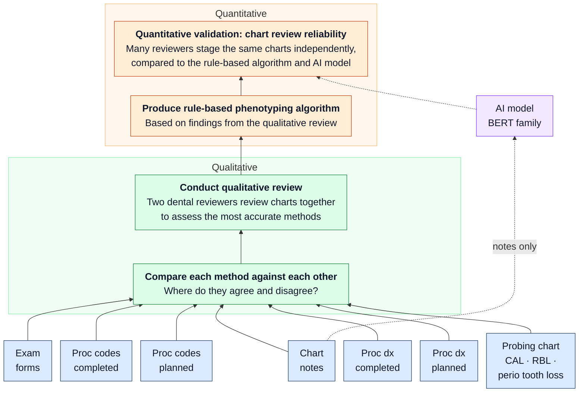

# Study process

A **phenotype** is a computable definition of a condition: a rule or model that reads a
patient's record and assigns a label (here periodontal status, stage, grade, extent)
the same way for every patient. This page shows how periodontal status is phenotyped from a dental EHR, and how each step maps
to this repo. The diagram is the study design; the table under it says where
each box lives.

## Where each step lives

| Step | Repo | Output |
|------|------|--------|
| Evidence types per visit: chart notes, exam forms, procedure codes (completed, planned), procedure diagnosis codes (completed, planned), probing chart | `python/health_transformation_lab_nlp/study.py` (generate), `sources.py` (codes, forms), `clinical_notes.py` (notes), `labels.py` (probing chart) | `data/datasets/answer_key/review_key.csv` |
| Read each evidence type | `note_reader.py` (notes), `sources.READERS` (forms, codes, diagnoses), chart staging rules in `labels.py` | one status per evidence type per visit |
| Compare each method against each other | `phenotype.agreement_matrix`, `phenotype.coverage` | `data/datasets/method_agreement.csv`, `method_coverage.csv` |
| Qualitative review | People. Reviewers work from `method_agreement.csv` and the disagreeing charts; their findings go into `docs/labeling_protocol.md` and `RULES_V0` | rules, written down |
| Rule-based phenotyping algorithm | `phenotype.phenotype_v0` + `RULES_V0` (placeholder hierarchy until the review sets it) | `algorithm_v0` column |
| AI model | `rungs.py` + `models.yaml`; `scripts/11_ai_predict.py` trains on `train.csv`, predicts the review charts | `ai_predictions_<model>.csv` |
| Many reviewers stage the same charts | Label Studio: `labelstudio/chart_review.xml`, tasks in `data/datasets/review_tasks.json` | Label Studio JSON export(s) |
| Reliability: reviewers vs algorithm vs AI | `scripts/12_import_review.py`, `scripts/13_reliability.py` (Python) and `r/R/04_reliability.R` (R), parity-tested | Fleiss' kappa, consensus, each method vs reviewers, **AI vs human acceptance test** (below) |

## Validation criterion: as reliable as a human reviewer

The top box replicates the case-validation approach OHDSI presented for
chronic-condition phenotypes: several people review the same cases
independently, AI models review them too, and an AI is acceptable if it
**agrees with the people at least as much as the people agree with each other**
([OHDSI 2023 plenary, *Improving the reliability and scale of case validation*](https://www.youtube.com/watch?v=scUssf863TI),
from about 49 min; Schuemie, Ostropolets et al., *npj Digital Medicine* 2025,
[doi:10.1038/s41746-025-01433-4](https://doi.org/10.1038/s41746-025-01433-4)).
They found wide variation between human reviewers, and LLM–human agreement
comparable to human–human.

How it's computed here (`reliability.agreement_vs_humans`, R twin in `04_reliability.R`):

1. **Human bar:** mean Cohen's kappa over every pair of reviewers. Each reviewer
   also gets their own mean kappa against the others, to show the human spread.
2. **Each method** (AI model, rule-based algorithm, each evidence type): mean kappa
   against every reviewer.
3. **Difference** = method − human bar, with a 95% paired bootstrap CI over charts.
4. **Verdict** against a non-inferiority margin fixed before looking (default
   0.05 kappa): *non-inferior* if the CI's lower bound is above −margin,
   *inferior* if its upper bound is below −margin, else *inconclusive*.

Comparing a method with the reviewer **consensus** instead would be unfair to the
humans, because each reviewer helped make the consensus. Output:
`data/review/[simulated_]reliability/agreement_vs_humans.csv`.

## Planned vs completed procedures

A dental record keeps two lists of procedures for each patient, and the study reads both:

| | Completed | Planned |
|---|---|---|
| What it is | Procedures actually performed, posted to the patient's ledger | Procedures on the **treatment plan**: what the clinician recommends next |
| What it shows | What was done, and what a claim would be billed for | The clinician's judgment of what the patient needs |
| Can differ because | Patients decline or defer care (cost, coverage, time), so a planned procedure may never be done | Plans can be revised, or never accepted |
| In claims data | Yes (claims are only for completed work) | No. Only the dental EHR has it |

Each procedure can carry an **ICD-10-CM diagnosis code** (e.g. K05.3x, chronic periodontitis), so
there are four streams: CDT procedure codes completed and planned (evidence types 3–4 in the README) and
procedure diagnosis codes completed and planned (evidence types 5–6).

**Example.** A patient with stage III periodontitis is planned for scaling and root planing
(D4341, diagnosis K05.3x) but declines. Completed shows only a periodontal evaluation and a
routine cleaning (D0180, D1110). Read alone, completed suggests gingivitis at most. The plan is
what shows the disease.

**In the synthetic data** (`sources.py`): planned codes follow the patient's true status; 20% of
patients with periodontitis decline, so their completed codes and completed diagnosis show
routine care; diagnosis codes appear at about 70% of visits, and their severity drifts.

**In the rule-based phenotype:** the diagnosis group checks completed diagnosis codes first, then
planned. CDT procedure codes are compared with the other evidence but not used to assign a status,
because a procedure says what was done, not the stage. Whether planned diagnoses should count the
same as completed ones is an open decision for the study lead (action item A2).

## Integrated phenotype and validation (spec 005)

| Step | Repo | Output |
|---|---|---|
| Integrated phenotype, five categories, study-design evidence order | `phenotype.RULES_DESIGN`, `collapse5`; `algorithm_design` column | `review_key.csv`, `visits_structured.csv` |
| Can the order change? Score all 24 orders, chosen on half the charts, reported on the other half | `scripts/18_phenotype_order.py` | `reliability_5cat/phenotype_orders.csv` |
| Reliability and acceptance test on five categories | `scripts/13_reliability.py` (Py + R) | `reliability_5cat/` |
| Patients over time; temporal plausibility | `synthetic.draw_history`, `plausibility.py` (Py + R) | `data_quality/` |
| Clinic-level prevalence, published comparison | `prevalence.py` (Py + R), `scripts/19_prevalence.py` | `prevalence/` |
| Data quality: conformance, completeness, plausibility | `dq.py`, `scripts/20_data_quality.py` | `data_quality/` |
| Prediction of progression, feature importance | `prediction.py`, `scripts/21_predict_progression.py` | `prediction/` |
| Status from the recorded chart, explained with SHAP (spec 013 G10) | `classify_status.py`, `scripts/40_classify_status.py` | `classify_status/` |
| Status from dental-only, dental+medical and medical-only features, SYNTHETIC (spec 023) | `classify_status.py`, `scripts/44_medical_features.py` | `classify_status/synthetic_medical_feature_sets*.csv` |

Differences from the study design and open decisions: [action_items.md](action_items.md).

## What's real and what's simulated today

Everything runs end to end on synthetic data. Two pieces are stand-ins:

- **The qualitative review** has not happened, so `RULES_V0` is a placeholder
  hierarchy (probing chart → note diagnosis → diagnosis codes → form → procedures).
- **The reviewers** are simulated (`12_import_review.py --simulate 4`) so the
  import and reliability code can be tested. Every simulated file is named
  `simulated_*` and every printout says so. They are not results.

## Real-data path (once approved)

Same code, different inputs. The EHR extract replaces `generate_visits`; the
de-identification gate runs inside the secure environment; only notes that pass
it are loaded into a Label Studio instance hosted inside that environment.
Real PHI never goes into Label Studio, this repo, or a model.
