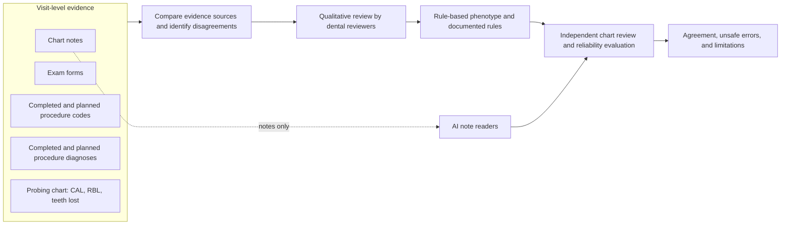
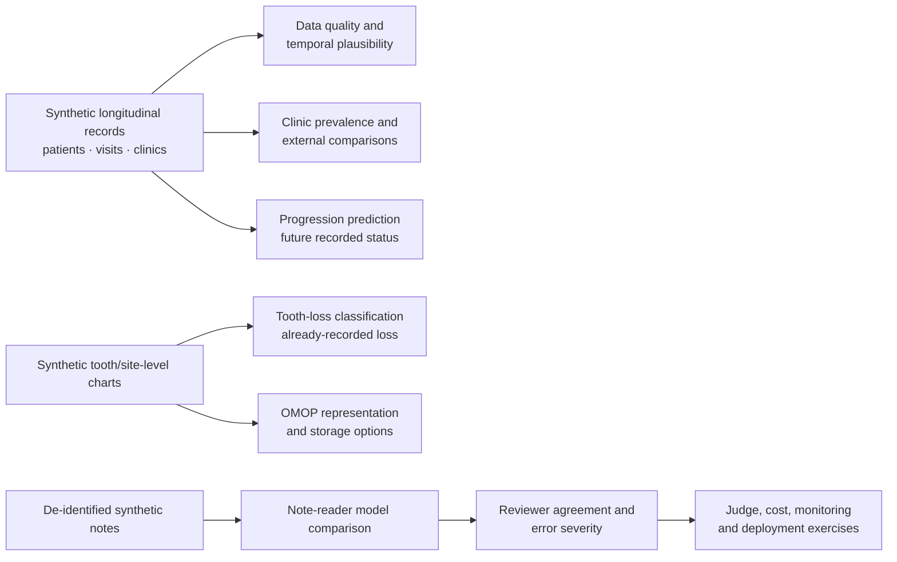

# Study design: workflow, variables, models, and interpretation

> **Start here for the study's design, implementation plan, and interpretation of associations, predictions, and causal claims.** This document is the study-design overview and navigation hub. It complements the detailed [study process](process.md), which remains the source of truth for process details, evidence rules, validation, and implementation mapping. This page links to existing protocols, variable references, risk assessments, and analysis plans rather than replacing them.
>
> **Project boundary:** this is a personal learning project using synthetic patient data. Synthetic results are pipeline dry runs, not clinical findings. No real-data study, clinical deployment, or employer/institutional research is implied. See the [disclaimer](../DISCLAIMER.md) and [real-data path and safeguards](process.md#real-data-path-once-approved).

## Purpose and current design

The study asks whether periodontal status can be derived reproducibly from dental EHR data, and whether an AI reading de-identified chart notes can perform comparably to clinicians reviewing the available chart. The design compares seven evidence types (notes, exam forms, completed and planned procedure codes, completed and planned procedure diagnoses, and probing charts), supports qualitative review and rule development, and evaluates agreement and safety-relevant errors. The broader repository also explores longitudinal plausibility, clinic-level prevalence, data quality, progression prediction, tooth-level tooth-loss classification, OMOP representation, and operational evaluation.

## Study workflow

This overview keeps the study flow visible here. Details, decisions, and where each step lives are in [Study process](process.md); the related outputs and open decisions are in [Action items](action_items.md).

### Complementary study analyses

These analyses address different questions and should not be read as one causal chain. Refer to [Action items](action_items.md) for what is implemented and what remains open.

## Models in the study

The model list below keeps the principal note-classification candidates visible in the study design. The registry in [`models.yaml`](../models.yaml) is the source of truth for IDs, checkpoints, roles, context lengths, and run configuration; the [model inventory](model_inventory.md) also covers non-classifier models, de-identification systems, hosted services, and licenses. See [BERT in plain language](bert.md).

### Note readers and classification baselines

- **In-house baselines:** note rules, structured rules, TF-IDF with logistic regression, and the radiograph-fusion baseline where applicable.
- **General-domain encoders:** BERT base; DistilBERT; ModernBERT base; ModernBERT large; Longformer.
- **Scientific/biomedical encoders:** SciBERT; BiomedBERT.
- **Clinical encoders:** Bio_ClinicalBERT; GatorTron base; BioClinical ModernBERT base; BioClinical ModernBERT large; Clinical-Longformer.
- **Instruction-tuned medical note readers:** MedGemma 1.5 4B and MedGemma 4B v1 have been evaluated on synthetic review notes; MedGemma 27B text is listed as a candidate, not a completed run.
- **Other LLM reader / judge options:** Llama and configured judge endpoints are documented in the model inventory and relevant analysis docs; their role depends on the specific experiment. A judge is not interchangeable with a note classifier.

The 12 encoder candidates in `models.yaml` are BERT base, DistilBERT, ModernBERT base, ModernBERT large, Longformer, SciBERT, Bio_ClinicalBERT, GatorTron base, BiomedBERT, BioClinical ModernBERT base, BioClinical ModernBERT large, and Clinical-Longformer. **SapBERT and GTE-ModernColBERT are not note classifiers**: they support concept linking or retrieval. The PHI taggers and de-identification services are also separate from periodontal classifiers. Model availability and run status can change; consult the registry and [inventory](model_inventory.md) for current status.

## Study-design document index

The linked documents remain authoritative for their particular protocol, variable definitions, assumptions, and decisions.

### Questions, protocol, population, and evidence

- [Study purpose, evidence flow, review and validation design, implementation map](process.md)
- [Scientific study overview, current scope, measured results, and limitations](edr/README.md)
- [Chart-review protocol](labeling_protocol.md) — reviewer outcome categories, staging rules, grade and extent
- [Rules for interpreting each evidence source](evidence_rules.md)
- [Periodontal staging and grading](staging_grading.md)
- [Planned versus completed procedures and their role in the phenotype](process.md#planned-vs-completed-procedures)
- [Differences from the intended study design and decisions still open](action_items.md)

### Variables, measures, predictors, and outcomes

- [Synthetic data card](synthetic_data.md) — generator variables, parameter values, provenance, sourced values versus placeholders, and checks. It describes synthetic records, not a real-cohort data dictionary.
- [Method choice and statistical approach](method_choice.md) — outcome types, methods, assumptions, independent unit, model predictors, validation, and feature-importance caveats.
- [PROBAST and TRIPOD+AI assessment](probast_tripod_ai.md) — participants, predictor sets, outcome definitions, missingness, splits, performance measures, and applicability for the synthetic status classifier.
- [Medical-record feature specification](../specs/023-medical-record-features/spec.md) and [implementation plan](../specs/023-medical-record-features/plan.md) — synthetic medical covariates and feature-set comparisons.
- [Phenotype-validation specification](../specs/005-phenotype-validation/spec.md) and [implementation plan](../specs/005-phenotype-validation/plan.md) — longitudinal validation, prevalence, data quality, and progression prediction.
- [Tooth-loss specification](../specs/029-tooth-loss/spec.md), [analysis plan](../specs/029-tooth-loss/analysis_plan.md), and [research notes](../specs/029-tooth-loss/research.md) — tooth-level labels, predictors, split, and analysis decisions.
- [Synthetic-data-parameters specification](../specs/033-synthetic-data-parameters/spec.md) — rationale and requirements for generator parameters.

### Risks, bias, privacy, and limitations

- [PROBAST and TRIPOD+AI assessment](probast_tripod_ai.md) — prediction-model risk-of-bias domains and applicability limits; its synthetic-benchmark assessment is not a real-cohort risk-of-bias finding.
- [Action items](action_items.md) — design gaps and open decisions, including outcome/horizon, misclassification, temporal plausibility, data quality, external comparison, and de-identification.
- [Clinical severity of errors and unsafe-rate method](dentbench_methods.md) — draft harm matrix and requirement for periodontist sign-off.
- [De-identification methods, test sets, leak gate, and limitations](deidentification.md) and [human-review protocol](deid_review_protocol.md).
- [Synthetic data card](synthetic_data.md) — distinguishes published sources from invented placeholders; see also the [synthetic-only project boundary](../DISCLAIMER.md).
- [Statistics and uncertainty](statistics.md) — kappa, confidence intervals, bootstrap, and acceptance-test interpretation.

### Analysis and interpretation

- [Correlation, prediction, and causation guide](correlation_prediction_causation.md) — which claims are supported by current analyses and what would be required for a separate causal study.
- [Study-process validation criterion](process.md#validation-criterion-as-reliable-as-a-human-reviewer) and [statistical explanation](statistics.md) — reviewer agreement and non-inferiority interpretation.
- [Prediction-model method choices and evaluation](method_choice.md#prediction-logistic-regression-and-xgboost-side-by-side); the current progression question and open decisions are in [Action items: Prediction](action_items.md#prediction).
- [Tooth-loss model overview](edr/README.md#tooth-level-model-was-a-missing-tooth-lost-to-gum-disease-spec-029) — classifies an already-recorded missing tooth; it does not predict future tooth loss.
- [Cost-effectiveness analysis](cost_effectiveness.md) — judge calibration, sampling, corrected accuracy, and cost assumptions.

## Questions the analyses answer

Keep these distinct questions separate in protocol, code, tables, and prose:

1. **Phenotyping / measurement:** How accurately and reproducibly does a method classify periodontal status from the information available at a visit, compared with an explicitly named reference (reviewers, consensus, or synthetic generator truth)?
2. **Description / association:** How do measured patient characteristics, evidence sources, or clinic context vary with recorded periodontal status or change? Associations describe the observed data; they do not establish why a difference exists.
3. **Prediction:** Using only information available at a defined prediction time, how well can a model forecast a specified future outcome over a defined horizon for a patient not used to fit or tune it?
4. **Causal effect:** What would happen to an outcome under a specified intervention compared with an alternative? This is a different target question and is **not answered** by the repository's current predictive or explanatory analyses.

## Priority companion: correlation vs. prediction vs. causation

This distinction is a first-class part of the study design, not a subsection buried in [statistics.md](statistics.md). Read this section alongside the dedicated [correlation, prediction, and causation guide](correlation_prediction_causation.md).

| Analysis in this project | What it can support | What it cannot support by itself |
|---|---|---|
| Correlation, prevalence comparisons, or regression coefficients | A description of a relationship in the analyzed sample, conditional on the specified model and data | A causal effect, proof that a feature is a confounder, or evidence that changing a feature changes disease |
| Feature importance or SHAP for a fitted model | How the model uses or associates inputs with its outputs in this dataset and model | Clinical importance, a causal mechanism, an intervention effect, or proof that the input is independently informative |
| A held-out prediction evaluation | Predictive performance for the defined outcome, time horizon, population, and validation split | Causality, transportability to a new clinic or population without suitable validation, or clinical utility without an impact evaluation |
| Agreement with chart reviewers or generator truth | Agreement with that named reference under the evaluated conditions | Biological ground truth, real-world clinical effectiveness, or causal evidence |
| A causal analysis, if separately proposed in the future | A causal estimate only under a prespecified design, defensible assumptions, appropriate data, and sensitivity checks | Automatic proof of causation merely because an adjusted model was used |

### Guardrails for the current analyses

- Call `21_predict_progression.py` a **prediction** analysis only when its outcome, index visit, prediction horizon, eligible population, feature availability, and patient-level validation split are stated. It estimates future recorded phenotype change, not the effect of smoking, diabetes, treatment, or another exposure. The existing [action items](action_items.md) document unresolved outcome and horizon decisions and synthetic-label limitations; keep those visible rather than implying they are resolved.
- Treat logistic-regression coefficients as model-conditional associations (and, for logistic models, odds-scale quantities), not causal effects. State the outcome, reference category, covariates, unit or contrast, uncertainty, and analytic sample. Avoid interpreting adjustment as sufficient to remove confounding.
- Describe SHAP and other feature-importance values as explanations of a particular fitted model's predictions. Correlated inputs can share, mask, or redistribute importance; values may change with the model, feature set, and background data. They do not identify causes.
- A patient-level split prevents visits or teeth from the same patient appearing across train and test partitions. Where the intended claim concerns performance at a new clinic or later time, also use an appropriately grouped clinic-held-out or temporal evaluation; a patient split alone does not establish that form of generalization.
- In longitudinal work, define the index time and ensure predictors precede the outcome. Check for leakage from future visits, derived labels, treatment decisions, or variables recorded after the prediction point. Explain how repeated visits and teeth nested within patients (and patients within clinics) are handled for uncertainty and evaluation.
- Separate model performance from clinical utility. Sensitivity, specificity, calibration, predictive values, and unsafe errors describe different properties; none alone shows that using the model improves care.
- Synthetic data can test code paths and known-generator behavior, but cannot establish real-world associations, prediction performance, prevalence, or causal effects. Label synthetic results and simulated reviewer results at the point of display, not only in a distant disclaimer.

## Implementation roadmap

This roadmap adds interpretation discipline without moving or duplicating the existing study artifacts. Use existing files as the source of truth for their current responsibilities.

| Phase | Repository change | Acceptance evidence |
|---|---|---|
| 1. Make the distinction prominent | Maintain `docs/correlation_prediction_causation.md`; link it from this design, `docs/process.md`, and the scientific-study entry point `docs/edr/README.md`. Add a short pointer from `docs/statistics.md` rather than relocating or removing its existing statistical material. | Links resolve; existing study-process and statistics sections remain intact. |
| 2. State the question before the model | For every descriptive, prediction, or proposed causal analysis, document the question, target population, unit of analysis, outcome/exposure, index time, comparator, and interpretation permitted. Update the relevant existing specification or analysis plan rather than creating duplicate competing plans. | A reader can tell whether each analysis describes, predicts, or estimates an effect and what its target is. |
| 3. Make prediction timing and validation explicit | For progression and tooth-level analyses, record outcome definition, horizon, predictors available at prediction time, patient-level grouping, missingness, split strategy, and any separate temporal or clinic-level validation. Retain the current patient split and existing metrics unless a reviewed plan justifies a change. | Tests or review checks show no patient leakage; reports identify the split and limits on generalization. |
| 4. Bound model interpretation | In coefficient, feature-importance, and SHAP reporting, name the model, outcome, feature set, reference/background data where relevant, and caveats for correlated features. Keep predictive explanation separate from causal interpretation. | Documentation and output labels use association/model-explanation language and do not call feature importance a cause. |
| 5. Treat causal inference as a separate proposal | Do not add a causal claim to the current study by relabeling prediction or adjustment. If a causal question is later approved, create a separately reviewed protocol/analysis plan that specifies the intervention or exposure, comparator, outcome, estimand, time zero, confounder rationale, identification assumptions, missing-data strategy, and sensitivity analyses. | No causal estimate is reported until the separate plan and assumptions are reviewed; synthetic runs are explicitly methodological examples only. |
| 6. Preserve traceability and current work | Keep `docs/process.md`, `docs/action_items.md`, `docs/statistics.md`, existing specs, and analysis plans as they are unless a targeted edit is required. Add cross-links and update the relevant source document; do not copy tables or overwrite historical decisions. | Existing links, definitions, decisions, open items, and result caveats remain available and consistent. |

## Definition of done

- [ ] The standalone correlation/prediction/causation guide is linked from this design; the study process and scientific-study entry point link to this design; `statistics.md` points to the guide without losing its current content.
- [ ] This design links readers to existing study variables/data card, outcome and reviewer protocol, prediction risk/reporting assessment, relevant analysis plans, and design risks/open decisions.
- [ ] The study flow diagrams and a maintained summary of the note-classification model candidates remain visible here; the detailed model inventory and registry stay linked as sources of truth.
- [ ] Existing evidence types and order discussion, reviewer acceptance test, planned/completed distinctions, real-data safeguards, and action items are retained.
- [ ] Each current analysis is described using the correct category: measurement/agreement, descriptive association, prediction, or a separately planned causal analysis.
- [ ] The progression prediction's outcome, index time, horizon, permitted predictors, patient-level split, and synthetic-label limitations are stated; unresolved choices remain marked open until decided.
- [ ] Tooth-loss classification is described accurately as classifying/explaining already-recorded missing-tooth status, not predicting future tooth loss, consistent with the [existing study overview](edr/README.md).
- [ ] Coefficients, SHAP, and feature importance are not presented as causal evidence; clustering, repeated visits, leakage, and generalization boundaries are acknowledged where relevant.
- [ ] Any causal analysis is gated on a distinct, reviewed estimand and assumptions; no causal claim is inferred from model accuracy, association, or covariate adjustment.
- [ ] All relative links resolve, and this documentation update does not alter analytic code, generated results, or the synthetic-data boundary.

## Core references

- [Study process and current repository mapping](process.md)
- [Differences from the design and open decisions](action_items.md)
- [Synthetic data card and variables](synthetic_data.md)
- [Method selection and statistical approach](method_choice.md)
- [Prediction risk and reporting assessment](probast_tripod_ai.md)
- [Model registry](../models.yaml) and [model inventory](model_inventory.md)
- [Statistics used here](statistics.md)
- [Scientific study overview](edr/README.md)
- [Learning plan and project boundary](plan.md)
